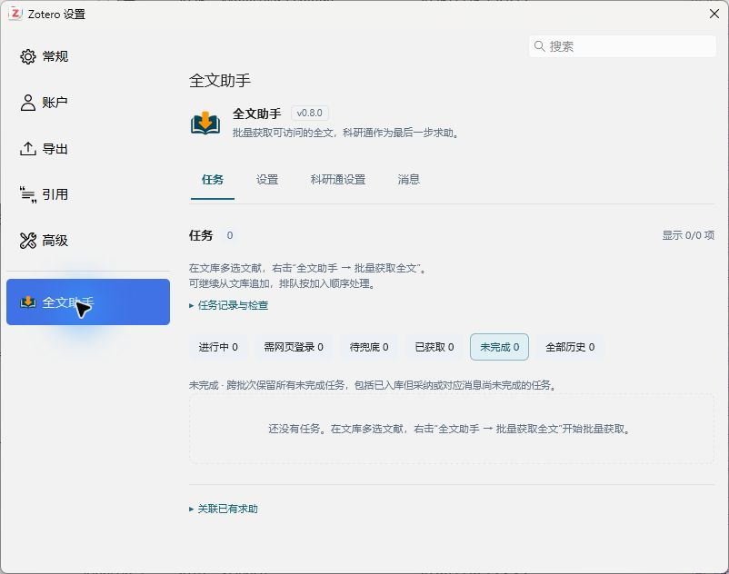
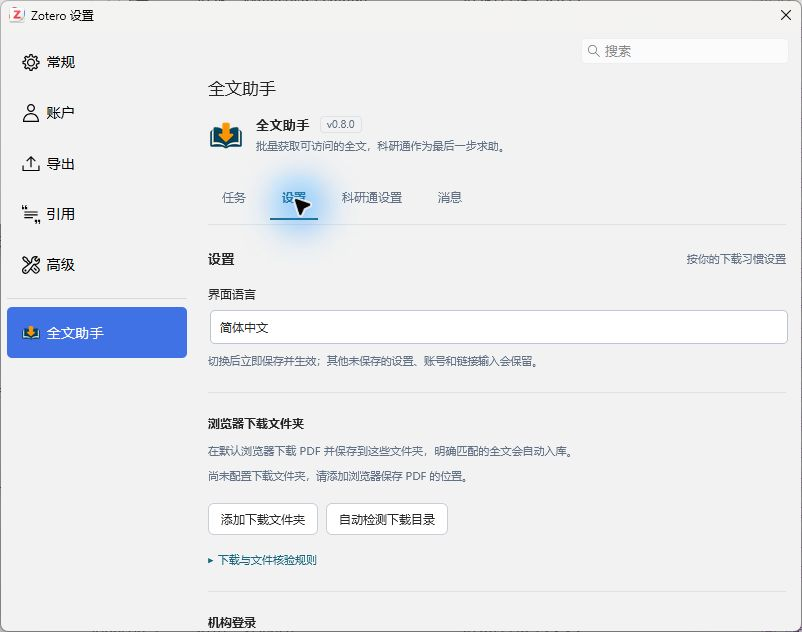

[简体中文](README.md) · [繁體中文](README.zh-TW.md) · **English**

<div align="center">
  
  <h1>Fulltext Assistant · 全文助手</h1>
  <p>Retrieve full texts in Zotero and attach browser downloads and AbleSci responses to the original items.</p>
</div>

[Download](https://github.com/zhangyehao/zotero-fulltext-assistant/releases/latest) · [Browser download guide](docs/browser-downloads.md) · [Support](SUPPORT.md) · [Privacy](PRIVACY.md) · [Publishing and updates](docs/PUBLISHING.md)

Fulltext Assistant tries open full-text sources and APIs before publisher pages. When a site requires manual sign-in or verification, download through your usual default browser; the plugin checks the PDF and attaches it to the original item. For remaining items, you can explicitly request help on AbleSci (科研通), wait for a response, verify the file, and accept it. Install one Zotero plugin; no browser extension is required.

The interface supports **Simplified Chinese (default), Traditional Chinese, and English**. This README describes **1.0.0**. This version's native acceptance ran on **Windows / Zotero 10.0.8**; earlier releases also have 10.0.7 records. The installation manifest permits **`10.0.7–10.0.*`**. macOS, Linux, Zotero 7/8/9, and 10.1+ are outside the verified support range. A permitted version is not a claim that every version in that range has been tested. Verification is recorded separately for each release. Supporting guides are currently in Simplified Chinese.

## What it does

| Situation | Behavior |
| --- | --- |
| Retrieve full text for a whole collection | Skip items with a usable local PDF before creating tasks; queue the rest and allow more batches to be appended. |
| An open full text is available | Try Zotero OA, OpenAlex, PMC / Europe PMC, CORE, and Semantic Scholar; verify candidate PDFs before attaching them. |
| A publisher page offers a PDF | After open sources, try the item URL, DOI landing page, and valid sessions inside Zotero. |
| Use another download source | Configure up to eight HTTPS templates containing `{doi}`, separated by semicolons or new lines; retrieve anonymously and verify the file. |
| Update the plugin | A compact header shows the check button, update status, and version; expand release details to read notes, explicitly install, or configure native automatic updates. |
| Your usual browser has institutional access | Complete sign-in, verification, and the download yourself; the plugin watches configured folders and imports matching new PDFs. |
| A downloaded PDF was not detected | Inspect download diagnostics, rescan downloaded files, or preview a related candidate and explicitly confirm it. |
| Request help on AbleSci | Sign in and authorize a request for each task; the default bounty is 10 points and is configurable, with an optional site-minimum setting. |
| An AbleSci response includes a file | Download automatically when enabled; after verification and import, accept the specific file and mark its upload notification as read. |
| Track unfinished work | The default Unfinished view spans all batches; completed records remain in All history, newest completion first. |

Availability still depends on access rights, subscriptions, expiring links, and site structure. The plugin cannot obtain every paper. Human verification is completed by you on the website.

## Installation

1. Open the [latest stable release](https://github.com/zhangyehao/zotero-fulltext-assistant/releases/latest) and download its `zotero-fulltext-assistant-<version>.xpi`. You do not need the source ZIP. Repository documentation may be updated before a release; use the version actually published on that page.
2. Open Zotero's plugin manager, choose **Install Plugin From File…** from the gear menu, and select the XPI.
3. Open **Zotero Settings → Fulltext Assistant**. Tasks, Settings, AbleSci settings, and Messages are tabs on this page. A separate sign-in webpage opens only when needed.

Third-party catalogs update independently of GitHub Releases. New entries may need review; normal stable releases of an already listed plugin are usually discovered automatically without another submission. Upstream collection, catalog builds, and website caching can delay the displayed version. If a catalog shows an older release, check the stable Release or Zotero's native update result separately; an old catalog version does not establish that installation failed.

## First use

1. Select one or more library items and choose **Fulltext Assistant → Batch retrieve full text** from the context menu. Items with a usable local PDF are skipped without creating a task. Add more items while a batch is running to append them to the queue.
2. Check the **Tasks** tab. Retrieved PDFs are attached to the original items; other tasks show the next available action. Click a title or DOI to copy it and see a brief confirmation.
3. For browser downloads, first add the actual destination under **Settings → Browser download folders**, then use **Browser download and auto-import** on the task. Complete verification and save the PDF in any configured folder.
4. To use AbleSci, open **AbleSci settings** and choose **Web sign-in**, or enter your account details and choose **Save and open sign-in**. Complete sign-in and any CAPTCHA on the real site. Review the bounty, polling interval, and automatic-download settings.
5. Explicitly choose AbleSci help for a remaining task. The context-menu action **Web first, AbleSci fallback (N points)** authorizes that batch to request help if web retrieval fails.

Ordinary **Batch retrieve full text** does not automatically publish new AbleSci requests. Eligible tasks keep the AbleSci fallback while waiting for a browser download. Tasks with an existing request continue processing that request instead of publishing another one.



This screenshot is from a blank 0.8.0 demonstration library and contains no user papers or account details.

## Pages and task scope

| Page | Contents |
| --- | --- |
| Tasks | Batch progress, next actions, PDF review, completed history, and linking existing requests. |
| Settings | Full-text sources, API keys, manuscript-version preferences, OpenAlex / CORE content allowances, interface language, download folders, and institutional sessions. |
| AbleSci settings | Sign-in, balance and check-in status, bounty, site-minimum option, polling interval, automatic download, and locally recorded spending. |
| Messages | AbleSci messages, refresh action, and last-refresh time. |

**In progress / Web sign-in needed / Fallback needed / Acquired** show only the latest submitted batch. **Unfinished** includes tasks needing attention across all batches. **All history** contains all acquired records, ordered by completion time, newest first. Starting a new batch changes only the current-batch views; older tasks and history remain. A record whose PDF is saved but whose acceptance or message processing is unfinished also remains in Unfinished.

Tasks and messages show **25 records per page** by default, with a **50-record** option. Search covers the complete collection within the current filter, rather than just the displayed page. Messages can be filtered by all, unread, or read; filtering does not mark them as read. Pagination does not delete older tasks or change totals. Acquired records can show the discovery provider separately from the actual PDF host; missing information in older records is not inferred.

The task select-all checkbox selects only the current page. Selections can accumulate across pages, while changing the search or filter clears them. When linking an existing request, the selector initially shows up to 50 candidates; search by title or DOI to find other items.



## Open full text, APIs, and manuscript versions

Choose sources and acceptable manuscript versions under **Settings → Full-text sources**. By default, published versions and accepted manuscripts are allowed, while explicitly identified preprints are excluded. A candidate with an unspecified version still undergoes paper-identity verification; the completed record says that its version is unverified. An API link is not a completed retrieval: a valid, matching PDF must be saved successfully.

Candidates can be downloaded and verified as each configured source returns them, without waiting for every query to finish. CORE without a key and custom sources are tried later. Authentication restrictions and rate limits temporarily pause the affected source while other sources remain available. These changes reduce unnecessary waiting; they do not guarantee a retrieval time or success rate for each paper.

- **OpenAlex:** Open locations and cached PDFs are separate. Entering a key does not enable cached-content downloads; authorize that allowance separately. The local daily cap defaults to 100 attempts and is persisted by UTC date and key hash. An attempt is reserved before download, including failed attempts. This cap is not the OpenAlex account balance and does not include other applications' use; it cannot guarantee that only free allowance will be consumed.
- **PMC / Europe PMC:** Uses current article datasets, PMCID conversion, and open full-text links, rather than the discontinued legacy PMC OA Web Service.
- **CORE:** First uses `downloadUrl` from a DOI-matching record. If that link cannot be used, its documented API can supply a hosted PDF through a verified output association. This path requires a key and a separate CORE content-download setting, which is **off by default**. The local daily cap defaults to **20 attempts**, adjustable from **1 to 1,000**. Attempts are reserved before download; failures, cancellations, and timeouts also count. This is neither the CORE balance nor a token meter and cannot guarantee that paid allowance will not be consumed. CORE does not publish a fixed token cost per PDF. Entering a key alone does not enable content downloads.
- **Semantic Scholar:** Uses `openAccessPdf.url` as a candidate; anonymous queries can be attempted or a key configured. After CORE/Semantic Scholar supplies a link, Zotero on your computer requests and verifies the file, without a developer-operated download proxy. A link may no longer be accessible, and a key does not provide publisher subscription rights. Purchasing these services is not a prerequisite for installing the plugin.
- **Custom sources:** Disabled by default, with no built-in mirror list. Add up to eight templates such as `https://example.org/{doi}`, separated by semicolons or new lines. Requests go only to public HTTPS targets and do not include AbleSci/institutional cookies or API keys. A login requirement or human-verification challenge stops that path. Availability depends on the configured website.

API queries and these candidate downloads use an anonymous web session; they do not inherit Edge, AbleSci, or institutional login cookies. An authenticated API receives only its own configured key. The later publisher-retrieval path is separate and can use a valid session saved inside Zotero. Use a task's **Source check details** to distinguish API discovery, candidate-file access, and identity-verification failures. Access restrictions or rate limits do not by themselves mean a service must be purchased.

API keys are stored separately in Zotero's login manager. Saving an empty key field keeps the existing key; explicitly select its removal to delete it. Keys are not stored in task history or logs. See the [full-text source guide](docs/fulltext-sources.md) for configuration and original service documentation.

## Downloads and verification

Your default browser keeps its own session. The plugin does not read Edge cookies or control browser tabs. Each watch lasts up to **30 minutes** and examines files directly inside the configured folders, without recursively scanning subfolders. Only a clearly matching PDF that maps uniquely to a task is imported automatically. The original downloaded file is retained.

If a task still waits after download, expand **Download check details**. The plugin distinguishes conflicts, low relevance, and insufficient identity evidence, and suggests at most three related candidates for preview. **Check downloaded files** rescans files created or modified since the task was created. Use **Choose downloaded PDF** for an older file. When review is needed, preview the file before confirming **I checked; this is the paper**. A reliable DOI/title conflict is not silently accepted.

Tasks with existing AbleSci requests can also check local downloads. Manually selecting a file requires preview and confirmation. After import, the plugin restores AbleSci as the source and continues acceptance only if the site's specific response file can be verified as byte-identical to the attachment. Otherwise, it retains the local full text and the request; use **Verify AbleSci file** again from history. See [browser downloads and PDF verification](docs/browser-downloads.md) for details.

## AbleSci points and sessions

- The default bounty is **10 points**, configurable as an integer from 1 to 10,000. Button labels follow the entered amount. Execution saves and captures the authorized amount; existing requests keep their original bounty.
- **Automatically accept the site's minimum bounty** is off by default and takes effect after saving. When enabled, a verified minimum above your setting is used. For example, a setting of 10 and a verified minimum of 30 result in a 30-point request. Processing stops if the balance is insufficient or the minimum cannot be verified. Queued tasks retain the authorization captured when they started.
- Completed AbleSci records show the verified actual bounty. Older records with unknown amounts are marked for verification. Spending totals cover only locally tracked, accepted requests with verified amounts; they are not a complete account statement.
- Once a response file is verified and saved, acceptance settles the original bounty, then only that file's upload notification is processed. An uncertain acceptance response is reconciled with the site first. A follow-up failure does not cause another download or a duplicate request.
- AbleSci account credentials and session backups use Zotero's local login manager. Web sign-in without saving a password is supported. Valid sessions can survive restart, though the site may require sign-in again. The institutional window can explicitly remember relevant site sessions after login.
- Downloads use a verified, currently available no-points high-speed entitlement when possible, otherwise the ordinary free route. The plugin does not automatically buy high-speed access.
- The check-in area displays status, balance, rewards, and an official webpage entry. You click the site's check-in button yourself; the plugin does not check in automatically. Polling and folder checks stop when Zotero is closed.

## Frequently asked questions

**My browser can download the paper. Why does the plugin show sign-in or fallback?**

The browser and Zotero have separate sessions. Failed automatic retrieval does not establish that you lack institutional access. Sign in through the institutional window or use your default browser. For an eligible locally obtained file, explicitly mark **Obtained through institutional access** in history to improve later guidance.

**I saved the PDF in the right folder. Why is the task still waiting?**

The file may predate the watch, still be writing, be inside an unconfigured subfolder, or lack reliably extractable identity evidence. Inspect the details, then rescan or choose the PDF manually; another download is not required. See the [troubleshooting guide](docs/browser-downloads.md#已下载但没有入库).

**A response already exists. Why was its file not imported?**

Check sign-in, automatic-download settings, and whether the request is linked to a Zotero item. A tracking-only request must be explicitly linked first. Follow the task's guidance for uncertain identity, expired files, or restricted access.

**Will tasks and history disappear after restart?**

Tasks, the current batch, and completed history are persisted locally. Browser-folder watches and ordinary candidate lists do not resume across restart; start another check with **Check downloaded files**. Pending AbleSci/API review files have their own recovery flow.

**Can the plugin bypass subscriptions or CAPTCHAs?**

No. It uses access you already have. If verification does not work inside Zotero, complete it yourself in your usual browser. The plugin does not impersonate human CAPTCHA clicks.

## Updates, privacy, and support

Version 0.8.0 introduced the public Zotero update URL while retaining the plugin's original ID. Users of the original 0.7.x packages must **manually install 0.8.0 or later once** to obtain that URL. Since 0.9.0, the settings page's update area can check for later versions, show release information, and install an update you explicitly choose. Automatic updates synchronize Zotero's native plugin-update option; Zotero controls their timing. A disabled global update setting is indicated. Checking alone does not install, and the plugin does not bypass native compatibility or hash validation with a separate installer. Third-party catalog versions come from their own collection pipeline and should be assessed separately.

There is no developer telemetry service. Enabled APIs, custom sources, publisher pages, AbleSci, and GitHub update checks still make the network requests required for their features. See [Privacy](PRIVACY.md) for download folders, credentials, task storage, stopping, and uninstall behavior. Follow [Support](SUPPORT.md) and remove private information before reporting a problem.

## Development and license

```sh
npm ci --ignore-scripts --no-audit --no-fund
npm test
python build.py --output dist
```

Tests include Node behavior checks, settings-page DOM regressions, and release-file verification. Results belong to the corresponding commit and release verification record; simulated tests are not real-site end-to-end validation. See the [maintainer publishing guide](docs/PUBLISHING.md) for artifacts and releases, and read [update notes and past pitfalls](docs/UPDATING.md) before changing or publishing the plugin.

[1.0.0 release notes](docs/release-v1.0.0.md) · [0.9.0 release notes](docs/release-v0.9.0.md) · [Documentation index](docs/README.md) · [Development history through 0.7.2](docs/development-history-v0.7.2.md)

Licensed under the [MIT License](LICENSE). This independently developed Zotero plugin is not officially affiliated with Zotero, AbleSci, or any publisher. The respective rights holders and service providers determine rights to use paper files.
