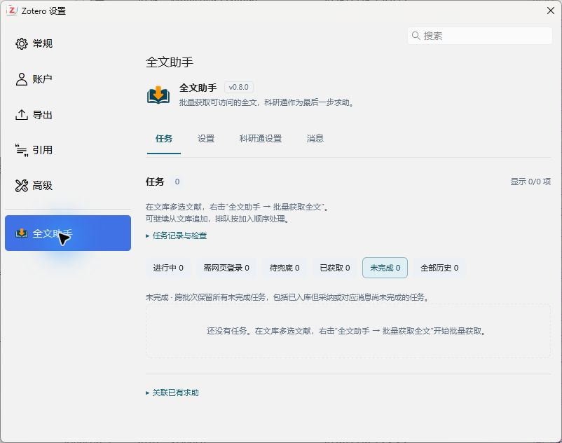
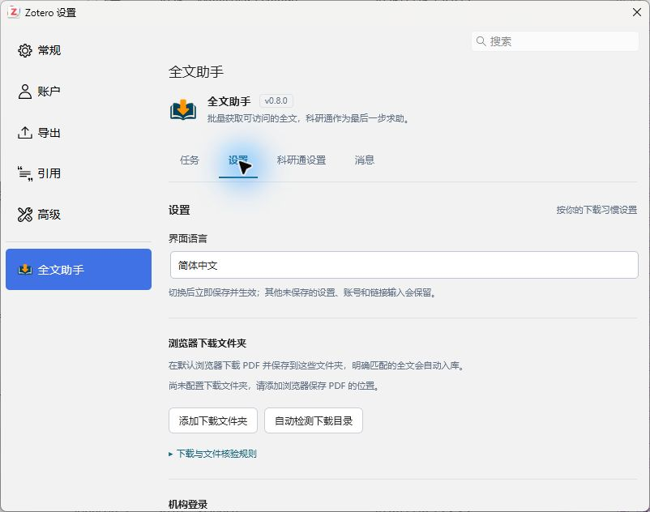

<div align="center">
  
  <h1>全文助手 · Fulltext Assistant</h1>
  <p>在 Zotero 中批量获取全文，把浏览器下载和科研通求助接回原文献。</p>
</div>

[下载安装](https://github.com/zhangyehao/zotero-fulltext-assistant/releases/latest) · [使用说明](docs/browser-downloads.md) · [问题反馈](SUPPORT.md) · [隐私说明](PRIVACY.md) · [发布与更新](docs/PUBLISHING.md)

全文助手先尝试论文网页和开放获取来源；需要手动登录或验证时，使用你日常的默认浏览器下载，再核对 PDF 并添加到原条目。仍未取得全文的任务，可以明确选择科研通求助，等待应助、核对文件并完成采纳。只安装一个 Zotero 插件，无需浏览器扩展。

界面提供 **简体中文（默认）、繁體中文、English**。本文面向 **0.8.0**；Windows / Zotero **10.0.7** 是已进行原生验证的环境，安装清单范围为 **`10.0.7–10.0.*`**。macOS、Linux、Zotero 7/8/9 及 10.1+ 尚不在已验证支持范围，安装范围不等于其中每个版本都已实测。

## 能做什么

| 场景 | 全文助手的处理 |
| --- | --- |
| 对分类中的全部文献批量获取 | 先跳过已有可用本地 PDF 的条目；其余任务按顺序排队，可以继续追加下一批。 |
| 论文网页可以直接下载 | 从条目网址、DOI 页面及 Zotero 开放获取解析器尝试取得 PDF，保存到原文献。 |
| 日常浏览器已有机构登录 | 你完成网页登录、验证和下载；插件检查指定目录中的新 PDF，核对身份后自动入库。 |
| PDF 已下载，却没有自动识别 | 查看下载诊断、重新检查已下载文件，或预览相关候选后明确确认。 |
| 需要科研通兜底 | 登录后按任务发起求助；默认每篇 10 积分，可调整，并可选择接受网站最低悬赏。 |
| 已有应助文件 | 按设置自动下载，核对并入库后采纳具体文件，将对应上传消息标为已读。 |
| 想知道哪些还没完成 | 默认查看跨批次“未完成”；完成记录按时间倒序保留在“全部历史”。 |

插件不会保证所有论文都能取得全文；网页权限、订阅范围、文件有效期和网站结构仍会影响结果。真人验证由本人在网站完成。

## 安装

1. 打开 [最新正式 Release](https://github.com/zhangyehao/zotero-fulltext-assistant/releases/latest)，下载 `zotero-fulltext-assistant-0.8.0.xpi`，或该页对应的新版本 XPI。无需下载源码 ZIP。
2. 在 Zotero 打开插件管理器，选择齿轮菜单中的“从文件安装插件…”，选中 XPI 并完成安装。
3. 打开 **Zotero 设置 → 全文助手**。任务、设置、科研通设置和消息均在这一页的横向标签中；登录网页仅在需要时单独打开。

第三方插件目录的申请、审核和采集独立于 GitHub 发布；请以目录实际展示为准，不能把发布 Release 视为已经收录。

## 第一次使用

1. 在文库选中一篇或多篇文献，右击 **全文助手 → 批量获取全文**。已有可用本地 PDF 的条目直接跳过，不新建任务；正在处理时可继续添加文献到队尾。
2. 在 **任务** 中查看结果。能直接获取的 PDF 会附加到原条目；需要网页处理的任务会显示下一步操作。点击标题或 DOI 可复制，旁边会显示短暂提示。
3. 浏览器能下载时，先在 **设置 → 浏览器下载文件夹** 添加实际保存位置，再点任务的 **浏览器下载并自动入库**。自行完成网页验证并下载到任一已配置目录。
4. 如需科研通，在 **科研通设置** 中点击 **网页登录**，或填写账号密码后点 **保存并打开登录**。在真实网站完成登录和验证码，再核对悬赏、检查间隔与自动下载选项。
5. 为仍未取得全文的任务明确选择科研通求助。也可以从右键菜单选 **网页优先，科研通兜底（N 积分）**，一次授权该批任务在网页获取失败后求助。

普通 **批量获取全文** 不会自动为新任务发布科研通求助。浏览器下载未完成时，符合条件的科研通入口仍会保留；已有求助则继续处理原求助，不重复发布。



截图来自 0.8.0 的空白演示文库，不含用户文献或账号。

## 页面和任务范围

| 页面 | 内容 |
| --- | --- |
| 任务 | 批量进度、下一步操作、PDF 核对、完成历史、关联已有求助。 |
| 设置 | 界面语言、浏览器下载目录、机构登录保存状态。 |
| 科研通设置 | 登录、余额与签到状态、悬赏积分、最低价选项、检查间隔、自动下载及本机支出记录。 |
| 消息 | 科研通站内信、刷新按钮和最近刷新时间。 |

任务页的 **进行中 / 需网页登录 / 待兜底 / 已获取** 只看最近一次批量操作；**未完成** 汇总所有批次仍需处理的任务；**全部历史** 汇总所有已获取全文的记录，按完成时间倒序。新一批会更新当前批次视图，旧任务与历史继续保留。PDF 已保存而采纳或消息处理尚未完成时，该记录也会留在“未完成”。



## 下载与核对

默认浏览器保留自己的登录状态，插件不读取 Edge Cookie，也不控制浏览器标签页。每次开始后，最多等待 **30 分钟**，只检查配置目录的直接文件，不递归子目录。明确匹配且唯一对应任务的 PDF 才自动入库；原下载文件会保留。

下载后仍在等待时，先展开 **下载检查详情**。插件区分明确不匹配、低相关与识别不足，并最多推荐 3 个相关候选供预览。点击 **检查已下载文件** 可重新检查任务创建后新增或修改的文件；更早的 PDF 可用 **选择已下载的PDF**。需要人工核对时，预览后点 **我已核对，是这篇论文**。可靠 DOI 与标题冲突的文件不会直接入库。

已有科研通求助也能检查本地下载。手选文件时会要求预览确认；入库后，只有核实网站具体应助文件与附件内容完全一致，才恢复科研通来源并继续采纳。不能核实时保留本地全文和原求助，可在历史中再次 **核验科研通文件**。详细范围见 [浏览器下载与文件核验](docs/browser-downloads.md)。

## 科研通积分与会话

- 默认悬赏 **10 积分**，可设为 1–10000 的整数。按钮会随积分输入更新；执行时保存并捕获本次金额，已发布求助保留原悬赏。
- **自动接受网站最低悬赏积分** 默认关闭，需保存后生效。开启时，网站已核实的最低要求高于设置值，就采用该最低值。例如基础值 10、最低要求 30，本次按 30 积分提交；余额不足或要求无法核实时停止。已排队任务保留启动时的授权。
- 已获取的科研通来源显示已核实的实际悬赏；旧记录金额不明时标注待核实。支出统计只覆盖本机已采纳且金额已核实的求助，不是网站完整账单。
- 应助文件核验并保存后，采纳会结算原悬赏，随后只处理该文件对应的上传通知。采纳响应不明时先核实网站状态；不会因为收尾失败重复下载或重新发布。
- 科研通账号密码和会话备份使用本机 Zotero 登录管理器保存。可以只网页登录而不保存密码。有效会话可跨重启复用，网站仍可能要求重新登录。机构窗口可在完成登录时明确记住相关站点会话。
- 下载优先使用账号当前已核实的免积分高速权益，否则使用普通免费线路；不会自动购买高速权益。
- 签到区提供状态、余额与奖励查询，以及官方网页入口。签到按钮由本人在官网点击；插件不会自动签到。关闭 Zotero 后不继续轮询或检查。

## 常见问题

**浏览器能下载，为什么插件提示登录或待兜底？**  
浏览器与 Zotero 的登录状态不同；自动获取失败也不代表没有机构权限。可在插件机构窗口完成登录，或使用默认浏览器下载。通过机构取得的适用本地文件，可在历史中明确标记“这是通过机构获取”，帮助后续提示。

**下载到了正确目录，为什么仍然等待？**  
可能是文件早于本次监控、仍在写入、位于未配置的子目录，或 PDF 无法可靠提取身份。先看下载详情，再用“检查已下载文件”或手选 PDF，不必重复下载。详见 [排查流程](docs/browser-downloads.md#已下载但没有入库)。

**为什么已有应助，却没有自动入库？**  
检查是否已登录、启用自动下载，以及求助是否关联了 Zotero 文献。“只跟踪，不关联文献”的任务需要先明确关联文献；身份不确定、文件过期或权限受限时按任务提示处理。

**重启后任务和历史会丢吗？**  
任务、当前批次和完成历史保存在本机；重启继续读取。浏览器目录监控及普通候选列表不会跨重启继续运行，用“检查已下载文件”重新开始即可。科研通待核对暂存文件另有恢复流程。

**能绕过机构订阅或验证码吗？**  
不能。插件使用你已有的访问权限；内置窗口无法完成验证时，请在日常浏览器自行完成。插件不会伪装真人点击验证码。

## 更新、隐私与反馈

0.8.0 配置公开的 Zotero 插件更新源，沿用原插件 ID。已安装 0.7.x 的用户需要先从 Release **手动安装一次 0.8.0 或更新版本**，才能使用新的更新地址。后续更新以 Zotero 插件管理器检查结果为准；发布者需要核实公开更新清单与安装包一致。

插件没有开发者遥测服务；论文网页、科研通和 GitHub 更新检查仍会按相应功能产生网络请求。下载目录、凭据、任务记录、停止与卸载行为见 [隐私说明](PRIVACY.md)。遇到问题请按照 [支持说明](SUPPORT.md) 提供去除隐私的信息。

## 开发与许可

```sh
npm ci --ignore-scripts --no-audit --no-fund
npm test
python build.py --output dist
```

测试包括 Node 行为检查、设置页 DOM 回归及发布文件检查；具体结果以对应提交的 CI 和版本验收记录为准。模拟测试不能代替真实网站端到端验证。构建产物与发行步骤见 [维护者发布指南](docs/PUBLISHING.md)；后续开发和发版前请读 [更新注意事项与踩坑记录](docs/UPDATING.md)。

[0.8.0 更新说明](docs/release-v0.8.0.md) · [历史文档索引](docs/README.md) · [0.7.2 及以前完整开发记录](docs/development-history-v0.7.2.md)

采用 [MIT License](LICENSE)。本项目是独立开发的 Zotero 插件，与 Zotero、科研通及各出版社没有官方隶属关系；论文文件的使用权限由相应权利人与服务提供方规定。
