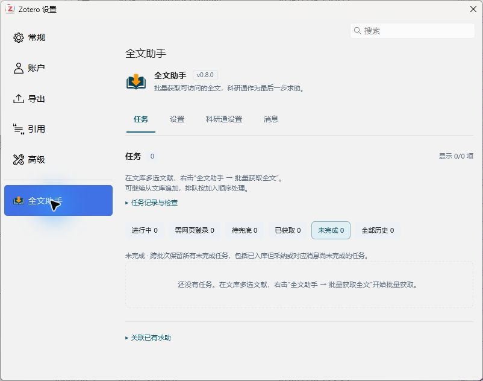
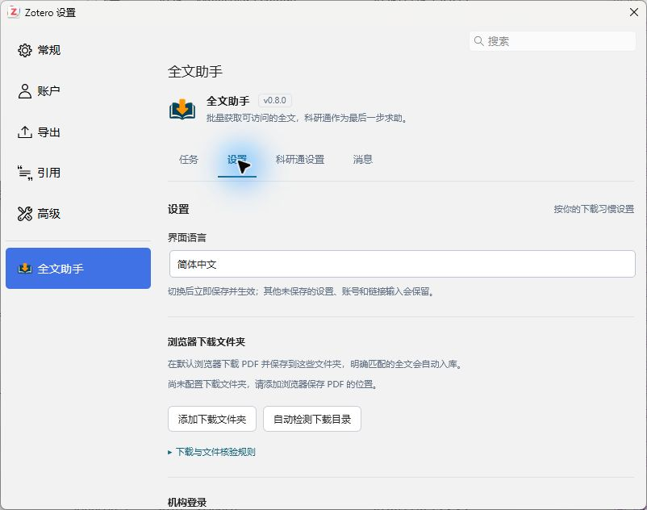

[简体中文](README.md) · **繁體中文** · [English](README.en.md)

<div align="center">
  
  <h1>全文助手 · Fulltext Assistant</h1>
  <p>在 Zotero 中批次取得全文，將瀏覽器下載及科研通求助檔案附加至原文獻。</p>
</div>

[下載安裝](https://github.com/zhangyehao/zotero-fulltext-assistant/releases/latest) · [使用說明](docs/browser-downloads.md) · [問題回報](SUPPORT.md) · [隱私說明](PRIVACY.md) · [發行與更新](docs/PUBLISHING.md)

全文助手優先嘗試開放全文與 API，再嘗試論文網頁；需要手動登入或驗證時，使用你平常的預設瀏覽器下載，再核對 PDF 並加入原條目。仍未取得全文的任務，可以明確選擇科研通求助，等待應助、核對檔案並完成採納。只安裝一個 Zotero 外掛，無需瀏覽器擴充功能。

介面提供 **簡體中文（預設）、繁體中文、English**。本文對應 **1.0.0** 的使用說明；本版實際原生驗收環境為 Windows / Zotero **10.0.8**，舊版已有 10.0.7 記錄，安裝資訊清單範圍為 **`10.0.7–10.0.*`**。macOS、Linux、Zotero 7/8/9 及 10.1+ 尚不在已驗證支援範圍，安裝範圍不代表其中每個版本都已實測。每次發行的實際驗證範圍分別記錄，不沿用舊版測試結果。其他詳細指南目前以簡體中文提供。

## 能做什麼

| 情境 | 全文助手的處理 |
| --- | --- |
| 對分類中的全部文獻批次取得全文 | 先略過已有可用本機 PDF 的條目；其餘任務依序排入佇列，可繼續加入下一批。 |
| 自動找到開放全文 | 優先使用 Zotero OA、OpenAlex、PMC / Europe PMC、CORE 和 Semantic Scholar；核驗候選 PDF 後附加至原條目。 |
| 論文網頁可直接下載 | 開放來源未成功時，從條目網址、DOI 頁面和 Zotero 內有效工作階段嘗試取得。 |
| 使用自己的下載來源 | 設定最多 8 個含 `{doi}` 的 HTTPS 範本，以分號或換行分隔；匿名取得並核對檔案。 |
| 更新外掛 | 頁首一行顯示檢查按鈕、更新狀態與版本；展開更新日誌可查看說明、明確選擇安裝或設定原生自動更新。 |
| 平常使用的瀏覽器已有機構登入 | 你完成網頁登入、驗證和下載；外掛檢查指定資料夾中的新 PDF，核對身分後自動匯入。 |
| PDF 已下載，卻沒有自動辨識 | 查看下載診斷、重新檢查已下載檔案，或預覽相關候選後明確確認。 |
| 需要科研通作為備援 | 登入後依任務發起求助；預設每篇 10 積分，可調整，並可選擇接受網站最低懸賞。 |
| 已有應助檔案 | 依設定自動下載，核對並匯入後採納指定檔案，將對應上傳訊息標為已讀。 |
| 想知道哪些尚未完成 | 預設查看跨批次「未完成」；完成記錄依完成時間倒序保留在「全部歷史」。 |

外掛不保證所有論文都能取得全文；網頁權限、訂閱範圍、檔案有效期限和網站結構仍會影響結果。真人驗證由本人在網站完成。

## 安裝

1. 開啟 [最新正式 Release](https://github.com/zhangyehao/zotero-fulltext-assistant/releases/latest)，下載該頁的 `zotero-fulltext-assistant-<版本>.xpi`。無需下載原始碼 ZIP；儲存庫文件可能早於正式發行更新，以該頁實際發行版本為準。
2. 在 Zotero 開啟外掛管理員，選擇齒輪選單中的「從檔案安裝外掛…」，選取 XPI 並完成安裝。
3. 開啟 **Zotero 設定 → 全文助手**。任務、設定、科研通設定和訊息都在這一頁的橫向分頁中；登入網頁僅在需要時另行開啟。

第三方外掛目錄與 GitHub Release 獨立更新。新條目可能需要審核，已收錄外掛的一般正式版本通常由採集器自動發現，不必每次重新申請；上游採集、目錄建置和網站快取仍可能延遲。目錄顯示舊版時，可先核對上面的正式 Release 或 Zotero 原生更新結果，不能將目錄舊版本號視為安裝失敗。

## 第一次使用

1. 在文庫選取一篇或多篇文獻，按右鍵選擇 **全文助手 → 批次取得全文**。已有可用本機 PDF 的條目直接略過，不建立任務；處理期間可繼續將文獻加入佇列尾端。
2. 在 **任務** 中查看結果。可直接取得的 PDF 會附加至原條目；需要網頁處理的任務會顯示下一步操作。按一下標題或 DOI 即可複製，旁邊會短暫顯示提示。
3. 瀏覽器能下載時，先在 **設定 → 瀏覽器下載資料夾** 加入實際儲存位置，再點任務的 **瀏覽器下載並自動匯入**。自行完成網頁驗證並下載至任一已設定資料夾。
4. 如需科研通，在 **科研通設定** 中點選 **網頁登入**，或填入帳號密碼後點 **儲存並開啟登入**。在真實網站完成登入和驗證碼，再核對懸賞、檢查間隔與自動下載選項。
5. 為仍未取得全文的任務明確選擇科研通求助。也可從右鍵選單選 **網頁優先，科研通備援（N 積分）**，一次授權該批任務在網頁取得失敗後求助。

一般 **批次取得全文** 不會自動為新任務發佈科研通求助。瀏覽器下載未完成時，符合條件的科研通入口仍會保留；已有求助則繼續處理原求助，不重複發佈。



截圖來自 0.8.0 的空白示範文庫，不含使用者文獻或帳號。

## 頁面與任務範圍

| 頁面 | 內容 |
| --- | --- |
| 任務 | 批次進度、下一步操作、PDF 核對、完成歷史、關聯已有求助。 |
| 設定 | 全文來源、API key、版本偏好、OpenAlex / CORE 內容額度、介面語言、瀏覽器下載資料夾與機構工作階段。 |
| 科研通設定 | 登入、餘額與簽到狀態、懸賞積分、最低價選項、檢查間隔、自動下載及本機支出記錄。 |
| 訊息 | 科研通站內信、重新整理按鈕和最近重新整理時間。 |

任務頁的 **進行中 / 需網頁登入 / 待備援 / 已取得** 只看最近一次批次操作；**未完成** 彙總所有批次仍需處理的任務；**全部歷史** 彙總所有已取得全文的記錄，依完成時間倒序排列。新一批會更新目前批次檢視，舊任務與歷史繼續保留。PDF 已儲存而採納或訊息處理尚未完成時，該記錄也會留在「未完成」。

任務和訊息預設每頁顯示 **25 項**，可切換為 **50 項**；搜尋作用於目前篩選下的完整記錄集合，不限於目前頁面。訊息可篩選全部、未讀、已讀，篩選不會將訊息標為已讀。分頁不刪除舊任務，也不改變統計總數。已取得記錄可分別顯示發現來源和實際 PDF 主機，舊記錄缺少的資訊不推測補齊。

任務的全選方塊只選目前頁面，可翻頁繼續累積選取；變更搜尋或篩選會清除選取。關聯已有求助時，下拉清單先顯示最多 50 個候選，可依標題或 DOI 搜尋其他條目。



## 開放全文、API 與版本

在 **設定 → 全文來源** 選擇來源與可接受版本。預設接受正式出版版或作者接受稿，排除已明確標示的預印本；版本未說明的候選仍會核對論文身分，完成記錄明確顯示「版本未核實」。API 回傳連結不代表已取得全文，只有有效且身分相符的 PDF 儲存成功才會進入「已取得」。

設定的來源回傳候選後即可開始下載與核對，不必等待所有來源查詢結束。未填 key 的 CORE 和自訂來源放在後續嘗試；同一來源受到認證限制或限流後會暫時退避，其他來源繼續執行。這些安排減少無效等待，不保證每篇文獻的取得時間或成功率。

- **OpenAlex**：開放位置和快取 PDF 分開處理。填入 key 不會自動允許快取內容下載，須另外啟用額度開關。本機每日上限預設 100 次，依 UTC 日期與 key 的雜湊值持久儲存；下載前先計次，失敗也占用本機計數。該上限不代表 OpenAlex 帳戶餘額或其他應用程式的消耗，不保證請求只使用免費額度。
- **PMC / Europe PMC**：使用目前文章資料集、PMCID 轉換及開放全文連結；不再使用已停用的舊 PMC OA Web Service。
- **CORE**：先使用 DOI 一致記錄提供的 `downloadUrl`。原連結無法使用時，可依官方契約從已核實的 output 關聯嘗試 API 託管 PDF；這條路徑需要 key，並須另外開啟 CORE 內容下載，預設關閉。本機每日上限預設 **20 次**，可設為 **1–1000 次**，下載前計次，失敗、取消和逾時也計入。它不是 CORE 餘額或 token 計量器，不保證不消耗帳戶付費額度；官網沒有公布每篇 PDF 的固定 token 成本。僅填入 key 不會開啟內容下載。
- **Semantic Scholar**：使用 `openAccessPdf.url` 作為候選，可先嘗試匿名查詢，也可設定 key。CORE/Semantic Scholar 提供地址後，由本機 Zotero 請求檔案並核對身分，不經過開發者下載伺服器。回傳連結不保證檔案仍可存取，key 不授予出版社訂閱權限；安裝外掛無需先購買這些服務。
- **自訂來源**：預設關閉，沒有內建鏡像清單。可貼上 `https://example.org/{doi}` 形式的地址；最多 8 個，以分號或換行分隔。只存取公開 HTTPS 目標，不傳送科研通／機構 Cookie 或 API key；遇到登入或真人驗證就停止該路徑。地址是否可用由網站決定。

API 查詢與這些候選下載使用匿名網頁工作階段，不繼承 Edge、科研通或機構登入 Cookie；需要認證的服務只接收它自己設定的 API key。後續出版社取得是另一條路徑，可使用 Zotero 內已儲存的有效工作階段。失敗時查看任務的 **來源檢查詳情**，區分 API 查詢、候選檔案存取和身分核對的問題；存取受限或限流不能直接解釋為需要購買服務。

API key 分別儲存在 Zotero 登入管理員中。留白儲存會保留現有 key，勾選清除才刪除；任務歷史與記錄檔不儲存密鑰。詳細設定與服務原始文件見 [全文來源說明](docs/fulltext-sources.md)。

## 下載與核對

預設瀏覽器保留自己的登入狀態，外掛不讀取 Edge Cookie，也不控制瀏覽器分頁。每次開始後，最多等待 **30 分鐘**，只檢查設定資料夾中的直接檔案，不遞迴掃描子資料夾。明確相符且唯一對應任務的 PDF 才自動匯入；原下載檔案會保留。

下載後仍在等待時，先展開 **下載檢查詳情**。外掛區分明確不相符、低相關與辨識不足，並最多推薦 3 個相關候選供預覽。點選 **檢查已下載檔案** 可重新檢查任務建立後新增或修改的檔案；更早的 PDF 可用 **選擇已下載的 PDF**。需要人工核對時，預覽後點 **我已核對，是這篇論文**。可靠 DOI 與標題衝突的檔案不會直接匯入。

已有科研通求助也能檢查本機下載。手動選取檔案時會要求預覽確認；匯入後，只有核實網站指定應助檔案與附件內容完全一致，才恢復科研通來源並繼續採納。無法核實時保留本機全文和原求助，可在歷史中再次 **核驗科研通檔案**。詳細範圍見 [瀏覽器下載與檔案核驗](docs/browser-downloads.md)。

## 科研通積分與工作階段

- 預設懸賞 **10 積分**，可設為 1–10000 的整數。按鈕會隨積分輸入更新；執行時儲存並擷取本次金額，已發佈求助保留原懸賞。
- **自動接受網站最低懸賞積分** 預設關閉，須儲存後生效。開啟時，網站已核實的最低要求高於設定值，就採用該最低值。例如基本值 10、最低要求 30，本次按 30 積分提交；餘額不足或要求無法核實時停止。已排入佇列的任務保留啟動時的授權。
- 已取得的科研通來源顯示已核實的實際懸賞；舊記錄金額不明時標示待核實。支出統計僅涵蓋本機已採納且金額已核實的求助，不是網站完整帳單。
- 應助檔案核驗並儲存後，採納會結算原懸賞，隨後只處理該檔案對應的上傳通知。採納回應不明時先核實網站狀態；不會因為後續處理失敗而重複下載或重新發佈。
- 科研通帳號密碼和工作階段備份使用本機 Zotero 登入管理員儲存。可以只透過網頁登入而不儲存密碼。有效工作階段可跨重新啟動重用，網站仍可能要求重新登入。機構視窗可在完成登入時明確記住相關站點工作階段。
- 下載優先使用帳號目前已核實的免積分高速權益，否則使用一般免費線路；不會自動購買高速權益。
- 簽到區提供狀態、餘額與獎勵查詢，以及官方網頁入口。簽到按鈕由本人在官網點擊；外掛不會自動簽到。關閉 Zotero 後不繼續輪詢或檢查。

## 常見問題

**瀏覽器能下載，為什麼外掛提示登入或待備援？**

瀏覽器與 Zotero 的登入狀態不同；自動取得失敗也不代表沒有機構權限。可在外掛機構視窗完成登入，或使用預設瀏覽器下載。透過機構取得的適用本機檔案，可在歷史中明確標記「這是透過機構取得」，協助改善後續提示。

**下載到正確資料夾，為什麼仍然等待？**

可能是檔案早於本次監控、仍在寫入、位於未設定的子資料夾，或 PDF 無法可靠擷取身分。先看下載詳情，再用「檢查已下載檔案」或手選 PDF，不必重複下載。詳見 [排查流程](docs/browser-downloads.md#已下载但没有入库)。

**為什麼已有應助，卻沒有自動匯入？**

檢查是否已登入、啟用自動下載，以及求助是否關聯 Zotero 文獻。「只追蹤，不關聯文獻」的任務須先明確關聯文獻；身分不確定、檔案過期或權限受限時，依任務提示處理。

**重新啟動後任務和歷史會遺失嗎？**

任務、目前批次和完成歷史儲存在本機；重新啟動後繼續讀取。瀏覽器資料夾監控及一般候選清單不會跨重新啟動繼續執行，可用「檢查已下載檔案」重新開始。科研通及 API 待核對暫存檔案另有復原流程。

**能繞過機構訂閱或驗證碼嗎？**

不能。外掛使用你已有的存取權限；內建視窗無法完成驗證時，請在平常的瀏覽器自行完成。外掛不會偽裝真人點擊驗證碼。

## 更新、隱私與回報

0.8.0 設定公開的 Zotero 外掛更新來源，沿用原外掛 ID。已安裝 0.7.x 的使用者須先從 Release **手動安裝一次 0.8.0 或更新版本**，才能使用新的更新地址。0.9.0 起也可在全文助手設定頁的更新區檢查更新、查看說明和安裝已發現的新版本。「自動更新」同步 Zotero 原生外掛更新選項，背景時間由 Zotero 決定；全域更新關閉時會明確提示。檢查本身不安裝，外掛不另設下載器繞過原生相容性和雜湊核驗。第三方市場顯示的版本來自其目錄採集，和這條原生更新路徑分別判斷。

外掛沒有開發者遙測服務；啟用的全文 API、自訂來源、論文網頁、科研通和 GitHub 更新檢查仍會依相應功能產生網路請求。下載資料夾、憑據、任務記錄、停止與解除安裝行為見 [隱私說明](PRIVACY.md)。遇到問題請依照 [支援說明](SUPPORT.md) 提供已去除隱私的資訊。

## 開發與授權

```sh
npm ci --ignore-scripts --no-audit --no-fund
npm test
python build.py --output dist
```

測試包含 Node 行為檢查、設定頁 DOM 迴歸及發行檔案檢查；具體結果以對應提交的 CI 和版本驗證記錄為準。模擬測試不能取代真實網站端對端驗證。建置產物與發行步驟見 [維護者發行指南](docs/PUBLISHING.md)；後續開發和發行前請讀 [更新注意事項與問題記錄](docs/UPDATING.md)。

[1.0.0 更新說明](docs/release-v1.0.0.md) · [0.9.0 更新說明](docs/release-v0.9.0.md) · [歷史文件索引](docs/README.md) · [0.7.2 及以前完整開發記錄](docs/development-history-v0.7.2.md)

採用 [MIT License](LICENSE)。本專案是獨立開發的 Zotero 外掛，與 Zotero、科研通及各出版社沒有官方隸屬關係；論文檔案的使用權限由相應權利人與服務提供者規定。
